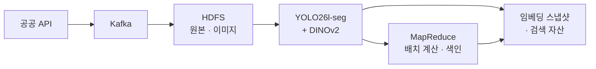
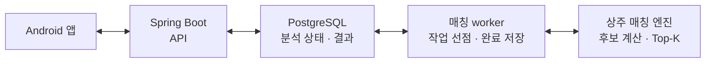

<div align="center">

# 🐾 MeonggoSpot · 멍고반점

### 사진 한 장으로, 잃어버린 가족을 찾는 여정을 돕습니다.

**실종 반려동물 사진과 전국 보호소·사용자 보호 동물을 비교해 유사 후보를 찾아주는 Android 서비스**


SSAFY 15기 특화 프로젝트 · 빅데이터 분산 처리 · 6인 팀

‘몽고반점’에 강아지의 울음소리 **멍**을 더한 이름입니다.

[서비스 소개](#서비스-소개) · [담당 역할과 기여](#담당-역할과-기여) · [주요 기능](#주요-기능) · [아키텍처](#아키텍처) · [기술적 의사결정](#기술적-의사결정) · [실험과 검증](#실험과-검증) · [코드 둘러보기](#코드-둘러보기)

</div>

---

## 서비스 소개

반려동물을 잃어버린 보호자는 여러 보호소와 게시판을 직접 확인해야 합니다. 사진의 배경·각도와 품종·색상 표기가 서로 달라, 같은 동물이어도 찾기 어렵습니다.

멍고반점은 **실종 사진을 검색의 출발점으로 삼습니다.** 공공 API에서 수집한 전국 보호소 입소 데이터와 사용자가 등록한 보호 게시물을 함께 검색하고, 사진 유사도와 축종·날짜·지역 조건으로 후보를 좁힙니다. 보호자는 후보의 상세 정보를 비교한 뒤 사용자와 채팅하거나 보호소에 연락할 수 있습니다.

### 사용자는 이렇게 이용합니다

| 1. 실종 정보 등록 | 2. 유사도 분석 요청 | 3. 후보 확인 | 4. 연락과 후속 확인 |
| :--- | :--- | :--- | :--- |
| 사진과 실종 날짜·지역을 입력합니다. | 본인 게시물에서 **유사도 분석하기**를 선택합니다. | 분석이 끝나면 조건에 맞는 **최대 20건**을 확인합니다. | 사진·발견 정보를 비교하고 작성자 또는 보호소에 연락합니다. |

사진 분석 결과는 **동일 개체 판정이 아닌 확인할 후보 목록**입니다. 서비스는 유사도 점수를 확률처럼 표시하지 않으며, 최종 확인은 보호자가 진행합니다.

## 담당 역할과 기여

**[@watermell0n](https://github.com/watermell0n) — Data 파트 전체 · 데이터 인프라 · Backend/Android 일부**

6인 팀에서 **공공 데이터 수집부터 임베딩 적재, 매칭 엔진, 분산 연산과 벡터 색인까지 데이터 처리 전반**을 맡았습니다. 데이터 처리 인프라를 구성하고, 서비스 연결을 위해 Spring 기반 채팅·알림 API와 Android 개발에도 일부 참여했습니다.

| 담당 영역 | 직접 구현하거나 참여한 내용 | 관련 코드 |
| :--- | :--- | :--- |
| **보호동물 수집·적재** | 공공 API 초기·일일 증분 수집, Kafka·HDFS 적재 파이프라인과 작업 자동화 | [수집기](data/collector/) · [Airflow DAG](data/airflow/dags/) |
| **이미지 임베딩·매칭 엔진** | 이미지 임베딩 처리·적재, 검색 스냅샷 활용, 후보 필터링·점수 집계·Top-K를 처리하는 매칭 엔진과 worker | [임베딩 러너](data/embedding/) · [매칭 엔진](data/match_engine/) · [worker](data/matching_worker/) |
| **MapReduce·벡터 색인** | kNN 조인·행렬곱·쎄타조인·자카드 셀프조인·K-Means 5종, 벡터 색인 구축과 검색 품질 평가 | [MapReduce](data/mapreduce/) · [평가 코드](data/eval/) · [실험 기록](data/experiments/) |
| **데이터 인프라** | 데이터 처리에 필요한 Hadoop·Kafka 클러스터와 서비스 운영 구성 | [클러스터 문서](docs/bigdata-cluster.md) · [운영 설정](infra/) |
| **Backend 일부** | Spring 기반 채팅·알림 API 개발 참여 | [채팅](backend/src/main/java/com/ssafy/backend/chat/) · [알림](backend/src/main/java/com/ssafy/backend/push/) |
| **Android 일부** | Android 앱 구현·연동 일부 개발 참여 | [Android 기능 코드](android/app/src/main/java/com/hotdog/meonggocuisine/feature/) |

## 주요 기능

| 기능 | 제공 내용 |
| :--- | :--- |
| **실종·보호 게시물** | 사진 1~10장, 날짜·지역·동물 정보 등록, 수정·종료와 목록 필터링 |
| **사진 기반 후보 검색** | 본인 활성 실종 게시물의 버튼 요청으로 비동기 분석, 공공·사용자 보호 동물 후보 최대 20건 제공 |
| **전국 보호소 데이터 연동** | 공공 API의 기존 데이터 수집과 일일 증분 갱신, 데이터 출처·갱신 상태 표시 |
| **일일 입소 요약** | 새로 적재된 보호동물 수와 보호소 수를 앱과 FCM 푸시로 안내 |
| **1:1 채팅** | 사용자 게시물 작성자와 텍스트 대화, 읽음 상태와 새 메시지 푸시 |
| **계정·개인정보 보호** | 휴대전화 OTP 인증, 인증 세션 관리, 전화번호·정확한 위치 암호화와 위치 공개 동의 |
| **입양 탐색 — P1 확장** | 보호 중인 공공 동물의 카드 탐색, 지역·축종·성별 필터, 찜과 넘김 기록 |

실종 동물 매칭은 사용자가 요청한 시점에 실행합니다. **신규 입소에 따른 자동 재분석·개별 후보 알림, 개인화 입양 추천, 재입소 개체 탐지**는 후속 확장 방향입니다. 입양 탐색의 카드·찜 기능과 AI 개인화 추천은 구분합니다.

## 아키텍처

**AI가 사진을 벡터로 바꾸고, 데이터 파이프라인과 분산 연산이 검색 자산을 준비하며, 상주 매칭 엔진이 사용자 요청을 처리합니다.** Spring Boot는 요청·권한·상태·결과를 관리합니다.

### 공공 데이터 수집과 배치 준비



공공 사진에서 임베딩을 생성하고 HDFS에 적재합니다. MapReduce는 저장된 벡터·메타데이터를 사용해 배치 계산과 색인을 수행합니다. 아래 사용자 요청에서는 상주 매칭 엔진이 준비된 임베딩 스냅샷을 로딩해 활용합니다.

### 사용자 요청과 비동기 매칭



두 그림은 매칭을 중심으로 단순화한 논리적 처리 흐름입니다. 사용자 사진도 HDFS에 저장하며, 요청 시 질의·사용자 후보 사진을 임베딩합니다. Redis는 인증 상태와 실패 제한을, FCM은 일일 요약과 채팅 알림을 담당합니다.

### 분석 요청의 처리 흐름

1. API가 분석 요청을 `match_run(PENDING)`으로 기록하고 **HTTP 202**를 반환합니다.
2. worker가 `FOR UPDATE SKIP LOCKED`로 작업을 선점해 `RUNNING`으로 전환합니다.
3. 상주 엔진이 검색 자산과 사진 임베딩을 사용해 후보를 계산합니다. **요청마다 모델이나 YARN 잡을 새로 시작하지 않습니다.**
4. worker가 후보와 `SUCCEEDED` 상태를 같은 트랜잭션에 저장하고, 앱이 상태·결과를 조회합니다.

[전체 시스템 설계](docs/architecture.md) · [매칭 worker](data/matching_worker/README.md) · [매칭 엔진](data/match_engine/README.md)

## 기술적 의사결정

| 해결할 문제 | 선택한 접근 | 설계 의도 |
| :--- | :--- | :--- |
| 사진마다 배경과 개체 크기가 다름 | **YOLO26l-seg** 탐지·마스킹·크롭 후 **DINOv2 ViT-B/14** 임베딩 | 배경 영향을 줄이고 외형을 768차원 벡터로 표현. 탐지 실패 시 원본 사진으로 폴백 |
| 대량의 사진을 반복 비교해야 함 | **Kafka → HDFS → MapReduce** 배치 파이프라인과 검색 자산 사전 준비 | 수집·전처리·분산 계산을 분리하고 요청 처리에서 이미 준비한 데이터를 재사용 |
| 전국의 닮은 동물이 후보에 섞임 | 축종·실종 날짜·지역 조건으로 후보 필터링, 사진 쌍의 **최대 코사인 유사도**로 개체 점수 집계 | 사용자 맥락으로 검색 범위를 좁히고 여러 사진 중 유효한 단서를 활용 |
| 무거운 분석과 API 응답의 수명이 다름 | **내구성 있는 DB 작업 큐 + 비동기 worker** | 요청을 저장한 뒤 계산을 분리하고, 중복 완료 방지와 장기 실행 작업 회수 처리 |
| 메시지 저장 후 푸시 발송이 실패할 수 있음 | **Transactional Outbox**와 발송 worker | 메시지·알림 이벤트를 함께 저장하고 푸시는 재시도. 채팅 기록은 DB 조회로 복구 |
| 전화번호·정확한 위치를 다룸 | 목적별 **AES-256-GCM 암호화**, 조회·인증용 HMAC, Redis TTL | 복호화가 필요한 정보와 원문을 보관할 필요가 없는 값을 구분하고 키·보존 정책을 분리 |

### MapReduce 알고리즘 구현

`data/mapreduce/`에는 **kNN 조인, 행렬곱, 쎄타조인, 자카드 셀프조인, K-Means**를 구현했습니다. 유사도 계산·조건 조인·특징 비교·클러스터 색인 등 대량 데이터 연산을 다루며, 단위 테스트와 분산 실행 실험을 별도로 기록합니다.

실제 사용자 요청은 [상주 엔진의 필터·점수·Top-K 규칙](data/match_engine/README.md)을 따릅니다. 개체 재식별과 핫스팟 분석처럼 알고리즘을 활용할 수 있는 확장 기능은 현재 서비스 기능과 구분합니다.

## 실험과 검증

### 약 45만 개 임베딩으로 검색 범위와 재현율 비교

**452,486개 × 768차원** 실벡터로 K-Means 색인을 구축하고, 평가 갤러리 **452,470장**에서 같은 개체의 서로 다른 사진 **20,000쌍**으로 정확 탐색과 클러스터 탐색을 비교했습니다.

| 실험 조건 | 탐색 후보 비율 | Recall@20 |
| :--- | ---: | ---: |
| 전체 정확 탐색 | 100% | 64.9% |
| K-Means 256개 클러스터 중 가까운 16개 탐색 | **7.06%** | **64.8%** |

후보를 약 **1/14**로 줄이는 조건에서 Recall@20 차이는 **0.1%p**였습니다. 이는 후보 축소와 검색 품질의 관계를 확인한 실험입니다. 해당 평가 구현에서는 클러스터 마스킹 비용으로 총 평가 시간이 증가했으므로, 이 결과를 응답 속도 향상으로 해석하지 않습니다.

> Recall@20은 정답 사진이 상위 20개에 포함된 비율입니다. 같은 개체의 공공 사진 쌍을 사용한 실험이며, 실제 실종 동물의 귀가 성공률이나 사용자 사진에 대한 정확도를 뜻하지 않습니다.

[실험 조건·전체 결과](data/experiments/2026-09-09-kmeans-real/README.md) · [대표 데이터셋 순위 평가](data/eval/results/repr-v1-rank-v2.md) · [평가 코드와 재현 방법](data/eval/README.md)

### 코드 품질과 운영 검증

- **Android**: ktlint와 JUnit 단위 테스트
- **Backend**: Spotless·Checkstyle, JUnit·Testcontainers 기반 API·DB 테스트
- **Data/AI**: pytest, 임베딩 순위·점수 집계 평가, MapReduce 실행 실험
- **협업·배포**: GitLab MR 검사와 AI 리뷰, Jenkins·Docker Compose 배포

## 기술 스택

| 영역 | 사용 기술 |
| :--- | :--- |
| Android | Kotlin 2.0 · Jetpack Compose · Hilt · Retrofit · FCM |
| Backend | Java 21 · Spring Boot 4.1 · Spring Security · JPA · Flyway |
| Database / Cache | PostgreSQL 17 · Redis |
| Data | Python · Kafka · Hadoop HDFS · MapReduce(Java 17) · Airflow |
| AI | YOLO26l-seg · DINOv2 ViT-B/14 · PyTorch · NumPy |
| Infrastructure | Docker Compose · nginx · Jenkins · GitLab CI |
| Collaboration | GitLab MR · Jira · lefthook · commitlint |

## 코드 둘러보기

```text
MeonggoSpot/
├── android/    Android 앱: 화면, 상태 관리, API·푸시 연동
├── backend/    REST API: 인증, 게시물, 사진, 매칭, 채팅, 입양 탐색
├── ai/         개체 전처리와 임베딩 파이프라인, 모델 명세
├── data/       공공 데이터 수집, MapReduce, 매칭 worker·엔진, 평가
├── infra/      배포·서비스 운영 설정과 스크립트
└── docs/       요구사항, API, ERD, 설계·운영 정책, 실험 관련 문서
```

| 살펴볼 내용 | 코드·문서 |
| :--- | :--- |
| 사용자 관점의 기능·화면 흐름 | [요구사항](docs/product/mvp-user-requirements-spec.md) · [사용자 흐름](docs/product/user-flow.md) |
| Android 구조 | [Android 아키텍처](android/ARCHITECTURE.md) · [기능별 코드](android/app/src/main/java/com/hotdog/meonggocuisine/feature/) |
| Backend 설계와 API | [개발 문서](backend/docs/README.md) · [API 명세](docs/api-spec.md) · [ERD](docs/erd.md) |
| AI와 매칭의 연결 | [DATA/AI 인터페이스](docs/data-ai-interface.md) · [모델 명세](ai/model.yaml) |
| 분산 처리 구현 | [MapReduce](data/mapreduce/README.md) · [평가 실험](data/eval/README.md) |
| 인증·개인정보·비동기 작업 | [보안·운영 정책](docs/backend-security-operations-policy.md) |

## 팀 구성

SSAFY 15기 6인 팀 프로젝트입니다.

| 팀원 | 담당 영역 |
| :--- | :--- |
| 준호 | 팀장 · AI |
| 민서 | AI |
| 병현 | Backend |
| 수경 | Backend · Data |
| 채원 | Android |
| 진광 | Infrastructure · Data |

## 개발 환경과 실행 안내

로컬 실행에는 **Node.js 24+, Java 21, Android Studio와 Android SDK 36, Docker**가 필요합니다. AI 모델 가중치와 공공 API·SMS·FCM 등 외부 연동 설정은 별도로 준비해야 합니다.

```bash
git clone https://github.com/watermell0n/MeonggoSpot.git
cd MeonggoSpot
npm run setup
```

전체 개발 환경 구성과 검사 명령은 [온보딩 가이드](docs/onboarding.md), 백엔드 설정은 [Backend 문서](backend/docs/README.md)를 참고하세요. 실제 비밀정보와 모델 가중치는 Git에 포함하지 않습니다.

---

이 저장소는 팀 프로젝트의 코드와 설계·실험 기록을 소개하는 **포트폴리오용 공개 저장소**입니다. 상세 문서에는 작성 시점의 설계 계획이 포함되어 있으므로, 현재 동작은 해당 구현 코드와 함께 확인할 수 있습니다.
